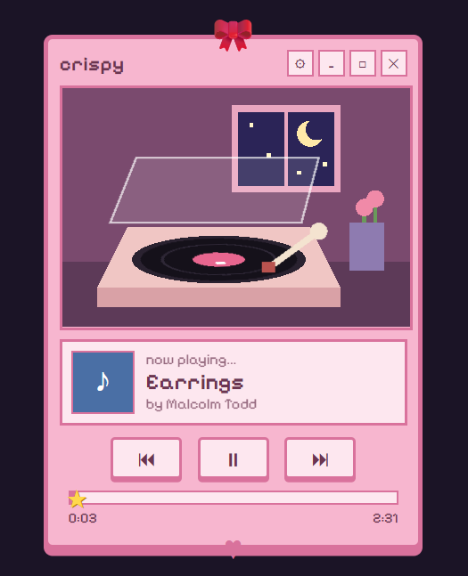
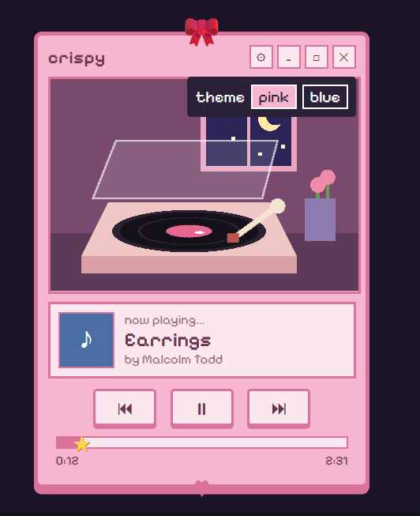
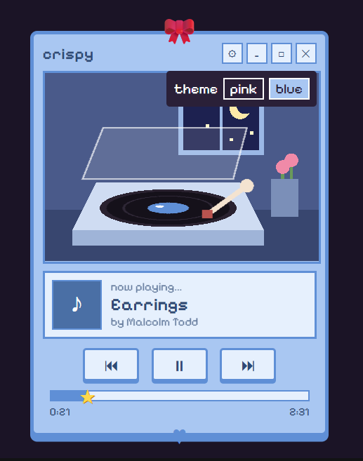

💗 Crispy – Pixel Music Player

A cute pixel-art music player for the browser, built with React and Vite. A vinyl record spins on a little turntable while your songs play.

Crispy pink theme

Screenshots
Pink theme	Settings menu	Blue theme
		
Features
Play, pause, next and previous controls
Spinning vinyl record, and a needle that lowers when music plays
Progress bar with a star handle you can drag to seek
Scrolling title for long song names
Pink and blue themes, switched from the settings (⚙) menu
Pixel-style window with a bow, hearts and a night-window scene, all drawn with SVG and CSS
Built With
React
Vite
JavaScript, HTML5, CSS
SVG for the turntable scene
Getting Started

You need Node.js installed.

bash
git clone https://github.com/YOURUSERNAME/crispy-player.git
cd crispy-player
npm install
npm run dev

Then open http://localhost:5173 in your browser.

Adding Your Own Music

The music files are not included in this repo.

Create a folder public/music.
Copy your .mp3 files into it.
Open src/App.jsx and edit the tracks list at the top:
jsx
const tracks = [
  { title: "Song Name", artist: "Artist", url: "/music/your-file.mp3", art: "#c0475a" },
];

The url must match the file name exactly. art is the color of the album square.

Project Structure
crispy-player/
├─ public/music/     # your mp3 files (not in the repo)
├─ screenshots/      # images used in this README
├─ src/
│  ├─ App.jsx        # player logic and layout
│  ├─ App.css        # themes and pixel styling
│  └─ index.css      # page background and font
└─ index.html
Roadmap
 Playlist view to jump to any song
 Shuffle and repeat
 Volume slider
 Desktop app with Electron
 Spotify / Apple Music playlists
Author

Made by Manasa Vernekar.